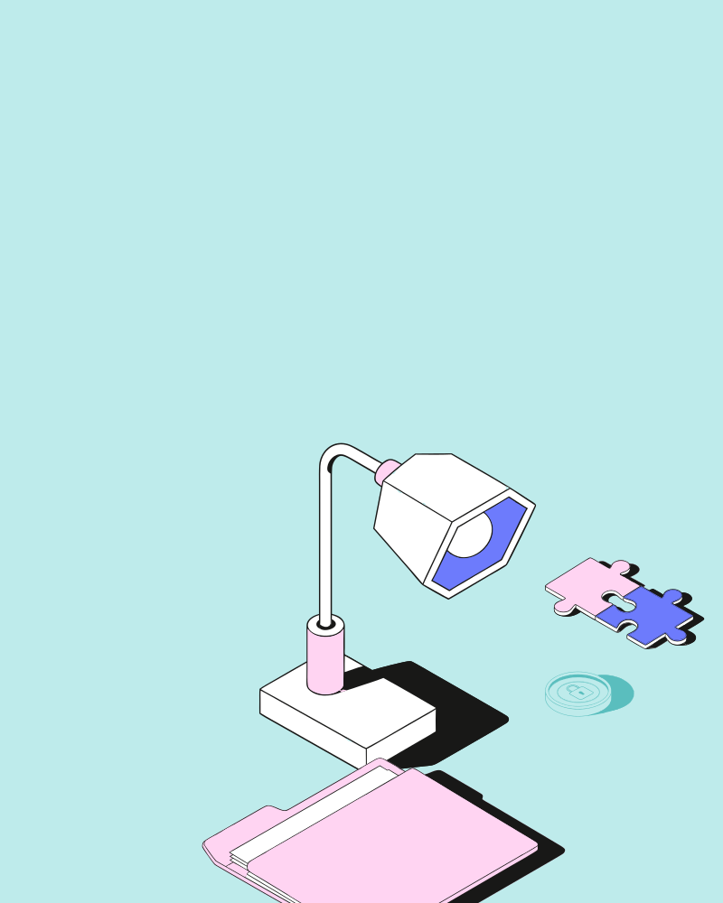

# Конструктор иллюстраций

Веб-сервис, который собирает композиции для иллюстраций из готовых векторных объектов — без генерации новых. Объекты не меняются: в итоговом SVG лежат их исходные пути, меняются только позиция, поворот, порядок слоёв и цвета по палитре.


## Что умеет

- **Автосборка, сценарий 1.** Пишете метафору или заголовок («Как начать копить деньги») — сервис подбирает подходящие объекты и раскладывает их в композицию.
- **Автосборка, сценарий 2.** Перечисляете объекты («книга, лампа, фоновые наушники») — сервис раскладывает их. Понимает падежи, количество («две книги») и фоновый вариант.
- **Три композиции из брифа:** «Под заголовок», «Со смещением», «Собранно». Кнопка «Другой вариант» — новая раскладка тех же объектов.
- **Ручная правка:** перетаскивание, поворот, дублирование, удаление, порядок слоёв, переключение «главный / фоновый», отмена и возврат действий.
- **Размер L / S** — детальные или упрощённые версии объектов, подгружаются автоматически.
- **Цветовые схемы:** три встроенные, загрузка своей палитры из JSON или создание в редакторе — композиция перекрашивается сразу.
- **Форматы холста:** 1200 × 630, 1080 × 1080, 1080 × 1350.
- **Экспорт в SVG:** векторный, без растра, каждый объект — отдельная группа с понятным `id`.

## Архитектура

### Извлечение объектов

Исходники — макеты из Figma с объектами в размерах L и S (по 10 объектов, главный и фоновый варианты — 40 файлов).

Скрипт [`tools/extract_objects.py`](tools/extract_objects.py):

1. PDF-экспорт из Figma переводится в SVG (`pdftocairo -svg`).
2. Все фигуры парсятся (`svgelements`), трансформации применяются к координатам.
3. Фигуры группируются в объекты по пересечению габаритов, объекты получают имена по положению на макете.
4. Каждый объект сохраняется отдельным SVG `<id>-<main|bg>-<L|S>.svg` с `viewBox` по своим габаритам.

Геометрия и цвета не меняются — только сдвиг в начало координат.

```bash
pdftocairo -svg "Размер L.pdf" L.svg
pdftocairo -svg "Размер S.pdf" S.svg
python3 tools/extract_objects.py src/library/svg L.svg S.svg
```

### Хранение

- `src/library/svg/*.svg` — 40 исходных объектов. Подключаются в сборку как текст (`import.meta.glob(..., '?raw')`), поэтому вставляются в итоговый файл без изменений и без растеризации.
- `src/library/catalog.ts` — описание объектов: название, синонимы (для сценария 2) и смыслы (для сценария 1).
- `src/library/assets.ts` — доступ к объекту по `id + вариант + размер`, размеры из `viewBox`.

### Переиспользование и сцена

Сцена — это не картинка, а данные: формат, размер, палитра, **один общий масштаб** и список объектов `{ id, вариант, x, y, поворот }`. Порядок в массиве — порядок слоёв.

Общий масштаб один на всю сцену, поэтому пропорции объектов относительно друг друга не меняются никогда — это ограничение из брифа заложено в модель данных. Один и тот же объект можно использовать сколько угодно раз: в SVG он каждый раз вставляется своей группой.

Холст и экспорт используют одни и те же функции (`itemTransform`, `itemBody`), поэтому скачанный SVG совпадает с тем, что на экране.

### Перекраска

У всех палитр одинаковая структура ролей: 3 цвета фона, 3 цвета объектов, тёмный и светлый. Объекты нарисованы в базовой палитре, поэтому перекраска — это замена каждого цвета на цвет той же роли в новой палитре, за один проход (`src/lib/palette.ts`).

Правило «цвета фона можно использовать в объектах, цвета объектов в фоне — нельзя» выполняется автоматически: фон холста всегда берётся из ролей фона, а объекты меняют цвета только по своим ролям.

Своя палитра загружается из JSON — пример в [`examples/palette-example.json`](examples/palette-example.json):

```json
{ "name": "Лес", "bg": ["#dcebd5", "#a9cf9b", "#5d9a52"], "obj": ["#ffe6a3", "#f28f6b", "#fde3d8"] }
```

### Автосборка

- **Подбор объектов по метафоре** (`api/compose.ts`): серверная функция отправляет заголовок в Claude со списком доступных объектов и получает JSON с главными и фоновыми. Ответ модели проверяется — принимаются только объекты из каталога. Ключ API хранится на сервере.
- **Запасной вариант без AI** (`src/lib/intent.ts`): поиск совпадений слов заголовка со смыслами объектов. Работает, если ключ не настроен или AI недоступен, — сервис всегда отвечает.
- **Раскладка** (`src/lib/layout.ts`): подбирается общий масштаб под нужную долю области, объекты расставляются жадно — от крупного к мелкому, каждый в свободную точку ближе к центру области. Главные почти не перекрываются, фоновые могут уходить под них. Если не помещается — масштаб уменьшается и раскладка повторяется. Случайность детерминирована (seed), поэтому «Другой вариант» воспроизводим.

## Запуск

```bash
npm install
npm run dev     # разработка
npm test        # тесты: перекраска, разбор запросов, раскладка, экспорт
npm run build
```

AI-подбор работает при деплое на Vercel с переменной окружения `ANTHROPIC_API_KEY` (модель можно задать через `ANTHROPIC_MODEL`). Без ключа используется локальный подбор.

## AI-инструменты

- **Claude Code** — основная разработка: архитектура, скрипт извлечения объектов, компоненты, тесты. Каждое изменение проверял вручную и в браузере.
- **Claude (API)** — в самом сервисе: подбор объектов под метафору.

## Примеры композиций

Файлы — в папке [`examples`](examples).

| Метафора «Как начать копить деньги» · Под заголовок | Список «книга, лампа, ручка, фоновые наушники» · Собранно | Метафора «Командная работа над проектом» · Со смещением, S |
|---|---|---|
|  |  |  |

## Стек

React 19, TypeScript, Vite, Tailwind CSS 4, Vitest, Vercel Functions.
